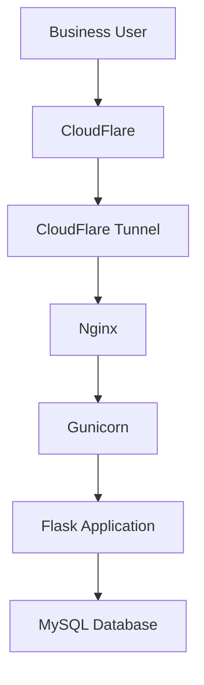

# Van Cik Lin - School Transport Invoicing System

A web-based invoicing and payment management system to support daily operations of school van transportation business.

Van Cik Lin started as a personal project to solve a real business problem; managing customer records, school transport fees, invoices, and payment records more efficiently. The system was built from scratch using Flask and MySQL and is currently used in my mother's school van business.

The project also serves as a hands-on experience in full-stack development, database design, Linux server administration, and self-hosted application deployment.

## Overview
The application helps manage the administrative work involved in operating a school van service, bringing customer information, billing and payment tracker into one web-application.

### Features
- Customer management - Maintain customer and student records
- Transport service management - Manage school transport services and associated fees.
- Payment tracking - Record and review customer payment information.
- Invoice generation - Generation invoices for school transport fees.
- PDF documents - Generate invoice and receipt documents.
- Dashboard and reports - View payment summaries and monthly trends through charts.
- Database-backend records - Store business information using MYSQL.

_Note - Features and workflows may evolve as the system is improved._

### Technology Stack
|Component|Technolgy|
|---------|---------|
|Backend|Python Flask|
|Database|MySQL|
|Frontend|HTML,CSS,Javascript,Bootstrap|
|Data tables|Datatables|
|Charts|Chart.js|
|PDF Generation|WeasyPrint|
|Application server|Gunicorn|
|Web server/reverse proxy|Nginx|
|Hosting and remote access|Proxmox homelab, Cloudflare Tunnel

### Architecture
The application is hosted on a self-managed homelab environment. Cloudflare Tunnel provides remote access without requiring direct public exposure of the application server.

This setup provides practical experience with application deployment, reverse proxy configuration, database connectivity, and remote access.

### Deployment Status

**Current Status: Deployed and in active business use** 

The application runs in a self-managed homelab environment and is accessible remotely through Cloudflare Tunnel.

The project remains under development, with further improvements planned for database design, maintainability, usability, and business workflows.

### Project Background
This project demonstrates the practical application of software development to a real-world small-business workflow.

It combines backend development, relational database management, user interface development, PDF generation, and self-hosted deployment in a single project.

Rather than building only a demonstration application, I developed and developed the system to support an actual family business,allowing improvements to be guided by real operational needs.